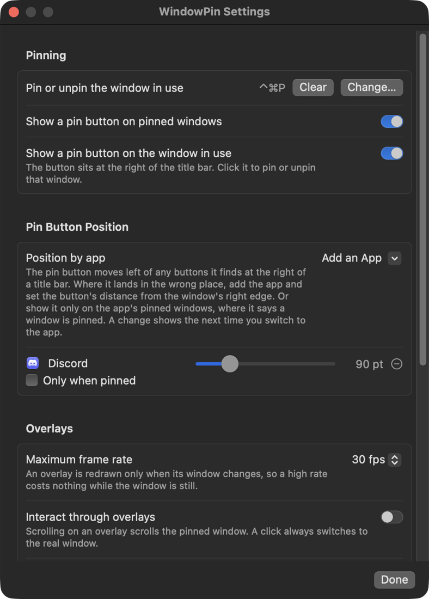

# WindowPin

Pin any window so it floats above everything else, like picture-in-picture
for any app. A pin is a live copy of the window, so you can keep a chart, a
chat or a build log in view while you work in something else.


This is a fork of [WindowPin by Jorvik Software](https://github.com/PerpetualBeta/WindowPin)
that has gone its own way (see [Credits](#credits)). It adds a pin button to window title bars, a setup
window for the permissions, and per-app settings for where the button sits.
It also does nothing at all while nothing is pinned or moving, and keeps most
of its logic in fast unit tests.

## Requirements

macOS 14 (Sonoma) or later.

## Install

The fork has no packaged releases yet. Build it from source with the Xcode 26
command line tools or later (Swift 6.2):

```sh
git clone https://github.com/SugarhouseTech/perch.git
cd WindowPin
make install   # builds and copies WindowPin.app to /Applications
```

Then open WindowPin. A setup window asks for the two permissions it needs
(see [Permissions](#permissions)) and shows each one as it is granted.

Run it from `/Applications`. On macOS 26 and later, menu bar managers such as
Bartender only see the icons of apps run from there.

## Pinning a window

Any of these pins the window in use, and does the same again to unpin it:

- Press `control` `command` `P`. You can change the shortcut in Settings.
- Click the pin button at the right of the window's title bar.
- Click the pin icon in the menu bar and choose the window at the top.

A badge flashes over the window to confirm. Closed windows are unpinned on
their own, and **Unpin All** in the menu clears every pin.

A pin floats over other apps. When you switch to the pinned window's app, the
pin drops behind the real window so you work with the app itself, and comes
back when you switch away.

A pin is a ScreenCaptureKit stream of the window. It updates as the window
changes, costs almost nothing while the window is still, and stops filming
while it is hidden.

### The pin button

The button sits at the right of the title bar, left of any buttons the app
has put there. It shows on the window in use, so you can pin it, and on pinned
windows, filled in, to show they are pinned. Either can be turned off in
Settings.

Some apps describe their title bars to macOS in a way WindowPin cannot read.
Where the button lands in the wrong place, add the app under **Pin Button
Position** in Settings and drag it into place. Discord comes set up already.
**Only when pinned** keeps the button off that app's windows until they are
pinned, so a pinned window can still always be told apart.



## Cropping a pin

You can keep just part of a window in view, such as a sports score on a web
page or the last lines of a long-running task.

1. `option`-drag across the pin to select the area to keep.
2. Release. The pin shrinks to that area and stays live.

Then:

- **Move it**: drag it anywhere.
- **Resize it**: drag an edge or corner to show more or less of the window
  around it, up to the window's own edges.
- **Crop it again**: `option`-drag inside it.
- **Show the whole window again**: `option`-click it.
- **Go to the real window**: click it.

A cropped pin stays on top while you use the app's other windows, and drops
behind only while you use the pinned window itself.

A crop is a fixed area of the window. If the page scrolls or reflows, or the
window is resized, what you wanted can move out of it; moving the window is
fine. A crop shows whatever the window shows, so switching a tabbed window to
another tab changes it. To watch one tab, drag it into its own window and pin
that. A minimised window stops updating.

## Using a pin

macOS 27 changed what one app may do to another's windows, so this depends on
your version. Keyboard input always stays with the app you are using: to type
into a pinned window, switch to it.

### macOS 27 and later

| Action | Result |
|---|---|
| Scroll on a pin | Scrolls the pinned window under the pointer, if **Interact through overlays** is on (off by default) |
| Click a pin | Takes you to the real window |
| `option`-drag a pin | Crops it |

Scrolling works through macOS's accessibility interface, so the app has to
offer one. Most Mac apps do, including Finder, Mail, Safari and Preview. Apps
built on Electron or Chromium often do not, and their pins will not scroll.

A pin cannot press buttons on macOS 27. The system now places a click sent
into another app's window at the window's corner rather than where you aimed,
so the click reaches nothing. WindowPin takes you to the window instead.

### macOS 14 to 26

With **Interact through overlays** on (the default here):

| Action | Result |
|---|---|
| Click, drag or right-click a pin | Sent to the real window: buttons, links and text selection work in place |
| Scroll on a pin | Scrolls the real window |
| `command`-click a pin | Takes you to the real window |
| `option`-drag a pin | Crops it. A cropped pin is moved by dragging and takes you to the window when clicked; scrolling still works |

With it off, any click on a pin takes you to the real window.

## Settings

Open **Settings…** from the menu bar icon, or open WindowPin again while it
is running.

- **Pinning**: the shortcut (**Clear** removes it, and pinning still works
  from the menu and the button), and whether to show the pin button on pinned
  windows and on the window in use.
- **Pin Button Position**: per-app button positions, as above.
- **Overlays**: the maximum frame rate (30 fps by default; a pin is only
  redrawn when its window changes), **Interact through overlays**, and
  **Pin to all spaces**, which shows pins on every Mission Control space
  rather than only the one they were made on.
- **Permissions**: whether each is granted, with a button to grant it.
- **Menu Bar** (macOS 14 and 15 only): hide the menu bar icon. On macOS 26
  and later, use System Settings → Menu Bar instead. With the icon hidden,
  open WindowPin again to reach Settings.
- **General**: launch at login, and an optional background behind the menu
  bar icon for busy wallpapers.

Settings are saved as you change them.

## Permissions

WindowPin needs two permissions, both in System Settings → Privacy &
Security. The setup window asks for them on first run, comes back at launch
while either is missing, and can be opened from the menu with **Finish
Setting Up…**.

- **Accessibility**: for the keyboard shortcut, the pin buttons, scrolling
  pins and bringing windows to the front.
- **Screen Recording**: to show a pinned window's contents. WindowPin films
  only the windows you pin, only while their pins are showing, and saves and
  sends nothing. macOS sometimes applies this permission only after a
  restart; the setup window has a button for that.

## Troubleshooting

**The shortcut or pin buttons stopped working after a rebuild.** A local
build is signed ad hoc, and macOS ties the Accessibility grant to that exact
build. Remove WindowPin from the Accessibility list and add it again, or sign
your builds with your own certificate (see [Building](#building)).

**A pin is blank.** Grant Screen Recording, then restart WindowPin.

**The menu bar icon is missing.** Run WindowPin from `/Applications`, or open
it again to bring up Settings.

**A pin is stuck on screen.** Choose **Unpin All** from the menu, or quit
WindowPin: every pin goes with it.

## Building

WindowPin uses Swift Package Manager; no Xcode project is needed.

```sh
make test      # unit tests, under a second
make app       # builds .build/local/WindowPin.app, signed ad hoc
make run       # builds and opens it
make install   # copies it to /Applications (set INSTALL_DIR to change)
```

WindowPin has no updater. To update, pull and run `make install` again.

To sign builds with your own Developer ID, so permissions survive rebuilds,
put this in a `local.mk` beside the Makefile (git ignores it):

```make
LOCAL_SIGN_ID   := Developer ID Application: Your Name (TEAMID)
LOCAL_BUNDLE_ID := com.example.WindowPin
```

To work on WindowPin, start with [AGENTS.md](AGENTS.md): it says where logic
lives and how it is tested.

## Credits

WindowPin was created by Jonathan Hollin of
[Jorvik Software](https://jorviksoftware.cc/), who released it into the
public domain. The heart of the app is their work: live pins, cropping, and
scrolling pins on macOS 27. So is the shared code in `Sources/JorvikKit`.
This fork started from the [original](https://github.com/PerpetualBeta/WindowPin)
in October 2026, and its history is kept here.

WindowPin has no third-party dependencies. It is built on Apple's
frameworks: ScreenCaptureKit for the live pins, the Accessibility API for
the pin buttons, scrolling and raising windows, and AppKit and SwiftUI for
the rest. Its tests use Swift Testing and XCTest.

## License

Public domain, under [the Unlicense](LICENSE), like the original.
