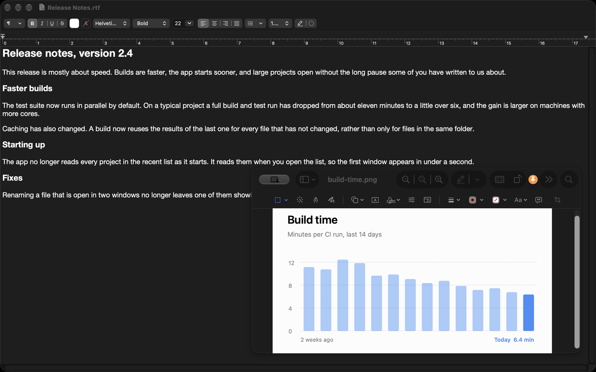

# Perch

Perch any window so it floats above everything else, like picture-in-picture
for any app. A perched window is a live copy of the real one, so you can keep
a chart, a chat or a build log in view while you work in something else.



Perch is made by Sugarhouse Tech. It began as WindowPin, by Jorvik Software,
and has gone its own way since (see [Credits](#credits)). It has a perch
button in window title bars, a setup window for the permissions, and per-app
settings for where the button sits. It does nothing at all while nothing is
perched or moving, and keeps most of its logic in fast unit tests.

## Requirements

macOS 14 (Sonoma) or later.

## Install

Perch has no packaged releases yet. Build it from source with the Xcode 26
command line tools or later (Swift 6.2). Nothing else is needed: no Xcode
project, no package downloads, no Apple developer account.

```sh
xcode-select --install   # if `swift --version` says less than 6.2
git clone https://github.com/SugarhouseTech/perch.git
cd perch
make install   # builds and copies Perch.app to /Applications
```

Then open Perch. A setup window asks for the two permissions it needs (see
[Permissions](#permissions)) and shows each one as it is granted.

Run it from `/Applications`. On macOS 26 and later, menu bar managers such as
Bartender only see the icons of apps run from there.

## Perching a window

Any of these perches the window in use, and does the same again to unperch
it:

- Press `control` `command` `P`. You can change the shortcut in Settings.
- Click the perch button at the right of the window's title bar.
- Click Perch in the menu bar and choose the window at the top.

A badge flashes over the window to confirm. Closed windows are unperched on
their own. The menu lists every perched window, the front app's first: choose
one to unperch it, or **Unperch All** to clear them all.

A perched window floats over other apps. When you switch to its app, the copy
drops behind the real window so you work with the app itself, and comes back
when you switch away.

The copy is a ScreenCaptureKit stream of the window. It updates as the window
changes, costs almost nothing while the window is still, and stops filming
while it is hidden.

### The perch button

The button sits at the right of the title bar, left of any buttons the app
has put there. It shows on the window in use, so you can perch it, and on
perched windows, filled in, to show they are perched. Either can be turned off
in Settings.

Some apps describe their title bars to macOS in a way Perch cannot read. Where
the button lands in the wrong place, add the app under **Perch Button
Placement** in Settings and drag it into place. Discord and Obsidian come set
up already. **Only when perched** keeps the button off that app's windows
until they are perched, so a perched window can still always be told apart.


## Cropping a perched window

You can keep just part of a window in view, such as a sports score on a web
page or the last lines of a long-running task.

1. `option`-drag across the perched window to select the area to keep.
2. Release. It shrinks to that area and stays live.

Then:

- **Move it**: drag it anywhere.
- **Resize it**: drag an edge or corner to show more or less of the window
  around it, up to the window's own edges.
- **Crop it again**: `option`-drag inside it.
- **Show the whole window again**: `option`-click it.
- **Go to the real window**: click it.

A cropped window stays on top while you use the app's other windows, and drops
behind only while you use the perched window itself.

A crop is a fixed area of the window. If the page scrolls or reflows, or the
window is resized, what you wanted can move out of it; moving the window is
fine. A crop shows whatever the window shows, so switching a tabbed window to
another tab changes it. To watch one tab, drag it into its own window and
perch that. A minimised window stops updating.

## Using a perched window

macOS 27 changed what one app may do to another's windows, so this depends on
your version. Keyboard input always stays with the app you are using: to type
into a perched window, switch to it.

### macOS 27 and later

| Action | Result |
|---|---|
| Scroll on a perched window | Scrolls the real window under the pointer, if **Scroll perched windows in place** is on in Settings (off by default) |
| Click a perched window | Takes you to the real window |
| `option`-drag a perched window | Crops it |

Scrolling works through macOS's accessibility interface, so the app has to
offer one. Most Mac apps do, including Finder, Mail, Safari and Preview. Apps
built on Electron or Chromium often do not, and their perched windows will not
scroll.

A perched window cannot press buttons on macOS 27. The system now places a
click sent into another app's window at the window's corner rather than where
you aimed, so the click reaches nothing. Perch takes you to the window
instead.

### macOS 14 to 26

With **Click and scroll perched windows in place** on in Settings (the
default here):

| Action | Result |
|---|---|
| Click, drag or right-click a perched window | Sent to the real window: buttons, links and text selection work in place |
| Scroll on a perched window | Scrolls the real window |
| `command`-click a perched window | Takes you to the real window |
| `option`-drag a perched window | Crops it. A cropped window is moved by dragging and takes you to the real window when clicked; scrolling still works |

With it off, any click on a perched window takes you to the real window.

## Settings

Open **Settings…** from the menu bar icon, or open Perch again while it is
running.

- **Perching**: the shortcut (**Clear** removes it, and perching still works
  from the menu and the button), whether to show a perch button on the window
  you're using and on perched windows, and what happens when you unperch a
  window: it comes to the front, ready to use (the default), or stays where
  it was.
- **Perched Windows**: whether you can scroll (and, before macOS 27, click)
  a perched window without leaving the app you're in; whether perched windows
  show on every desktop or only the one they were perched on; and the update
  speed, up to 30 times a second by default. A perched window only redraws
  when its window changes.
- **General**: open at login, and a background behind the menu bar icon for
  busy wallpapers.
- **Menu Bar** (macOS 14 and 15 only): hide the menu bar icon. On macOS 26
  and later, use System Settings → Menu Bar instead. With the icon hidden,
  open Perch again to reach Settings.
- **Permissions**: whether each is granted, with a button to grant it.
- **Perch Button Placement**: per-app button positions, as above.

Settings are saved as you change them. Settings from WindowPin, the app's
earlier name, are carried over the first time Perch runs.

## Permissions

Perch needs two permissions, both in System Settings → Privacy & Security.
The setup window asks for them on first run, comes back at launch while
either is missing, and can be opened from the menu with **Finish Setting
Up…**. While one is missing, the menu bar icon has a red dot.

- **Accessibility**: for the keyboard shortcut, the perch buttons, scrolling
  perched windows and bringing windows to the front.
- **Screen Recording**: to show a perched window's contents. Perch films only
  the windows you perch, only while they are showing, and saves and sends
  nothing. macOS sometimes applies this permission only after a restart; the
  setup window has a button for that.

## Troubleshooting

**The shortcut or perch buttons stopped working after a rebuild.** A local
build is signed ad hoc, and macOS ties the Accessibility grant to that exact
build. Remove Perch from the Accessibility list and add it again, or sign your
builds with your own certificate (see [Building](#building)).

**A perched window is blank.** Grant Screen Recording, then restart Perch.

**The menu bar icon is missing.** Run Perch from `/Applications`, or open it
again to bring up Settings.

**A perched window is stuck on screen.** Choose **Unperch All** from the
menu, or quit Perch: every perched window goes with it.

## Building

Perch uses Swift Package Manager; no Xcode project is needed.

```sh
make test      # unit tests, under a second
make app       # builds .build/local/Perch.app, signed ad hoc
make run       # builds and opens it
make install   # copies it to /Applications (set INSTALL_DIR to change)
```

Perch has no updater. To update, pull and run `make install` again.

To sign builds with your own Developer ID, so permissions survive rebuilds,
put this in a `local.mk` beside the Makefile (git ignores it):

```make
LOCAL_SIGN_ID   := Developer ID Application: Your Name (TEAMID)
LOCAL_BUNDLE_ID := com.example.Perch
```

`make release` builds the download: a universal app for Apple silicon and
Intel, signed with that Developer ID, notarised by Apple and stapled, then
zipped with a SHA-256 beside it in `.build/release-app`. It runs the tests
first, builds from scratch and refuses uncommitted changes, so a commit always
gives the same app. The version comes from `Info.plist` and the build number
from the commit count. It needs a notarytool profile, made once:

```sh
xcrun notarytool store-credentials perch-notary --apple-id you@example.com --team-id TEAMID
```

The steps are in [scripts/release.sh](scripts/release.sh).

To work on Perch, start with [AGENTS.md](AGENTS.md): it says where logic lives
and how it is tested.

## Credits

Perch began as [WindowPin](https://github.com/PerpetualBeta/WindowPin), created
by Jonathan Hollin of [Jorvik Software](https://jorviksoftware.cc/), who
generously released it into the public domain. Thank you, Jonathan. The heart
of the app is their work: live copies of windows, cropping, and scrolling them
on macOS 27. So is the shared code in `Sources/JorvikKit`. Perch started from
the original in October 2026, and that history is kept here.

Perch has no third-party dependencies. It is built on Apple's frameworks:
ScreenCaptureKit for the live copies, the Accessibility API for the perch
buttons, scrolling and raising windows, and AppKit and SwiftUI for the rest.
Its tests use Swift Testing and XCTest.

## License

Public domain, under [the Unlicense](LICENSE), like the original.
